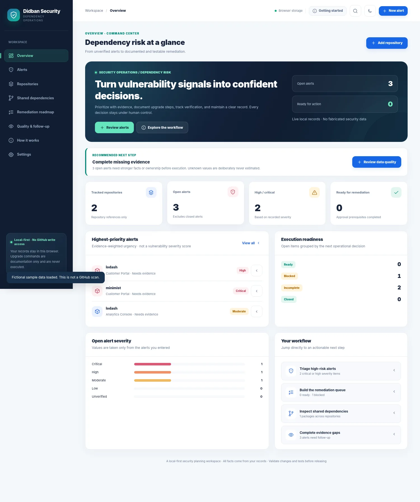
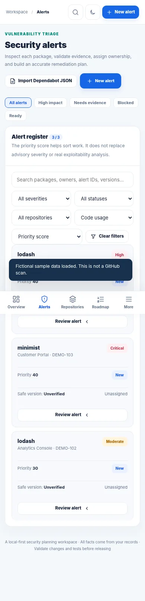

<div align="center">

# 🛡️ Didban Security

**Dependency vulnerability triage, prioritization, and remediation planning — without the noise.**

A polished, open-source, **local-first** security operations workspace for turning GitHub Dependabot alerts into a documented, risk-aware execution plan.

[](./LICENSE)   

**[Live English demo](https://didban-security-en.vercel.app)** · **[Quick start](#quick-start)** · **[Security model](#privacy-and-security-model)** · **[Contributing](./CONTRIBUTING.md)**

</div>

---

## Preview



<details>
<summary><strong>View the responsive mobile interface</strong></summary>



</details>

*Screenshots use fictional demo records; they are not live GitHub security findings.*

## Why Didban?

GitHub tells you *what* is vulnerable. An engineering team must still determine which alerts actually affect its code, whether an upgrade is compatible, how to roll it back, which tests are required, and when the work can be considered complete.

**Didban organizes that decision process** without pretending to have scanned your repositories or automatically fixed any package.

### What you can do

| Capability | What it solves |
| --- | --- |
| **Security command center** | An honest snapshot of open alerts, high/critical risk, the ready queue, blockers, and next steps. |
| **Repository & alert inventory** | Track GitHub repositories, advisory numbers, package versions, direct/transitive dependency paths, owners, due dates, and sources. |
| **Transparent priority score** | Sort work by advisory severity, confirmed code usage, cross-repo occurrence, and a documented manual override. |
| **Evidence-based triage** | Mark a package as used or unused **only** with an evidence note and review date; unknown facts remain unknown. |
| **Shared dependency map** | See which npm packages affect multiple registered repositories, without assuming one fix applies to all. |
| **Remediation roadmap** | Separate ready, blocked, incomplete, and closed work. Reorder only the ready queue. |
| **Upgrade playbooks** | Record exact npm commands, reviewer approval, compatibility assessment, prerequisites, migration details, and rollback. |
| **Test tracking & closure** | Record manual regression results. Require plan readiness and a passing test to resolve; document risk acceptance separately. |
| **Dependabot JSON import** | Import npm advisory records with validation, preview, and duplicate detection before committing. |
| **Data-quality review** | Find missing evidence, unverified severity, unassigned owners, missing safe versions, and overdue items. |
| **Export & portability** | Download JSON backups, CSV registers, and Markdown reports. Import backups from earlier Persian Didban releases. |
| **Onboarding and fast navigation** | Guided first run, permanently available workflow guide, responsive layout, dark mode, and Ctrl/⌘+K search. |

## Quick start

There is **no build step, backend, account, database, or GitHub token** required.

```bash
git clone https://github.com/AminVost/didban-security.git
cd didban-security
python3 -m http.server 4173
```

Open **http://localhost:4173**. You can also deploy the repository as a static website on Vercel, Netlify, Cloudflare Pages or GitHub Pages.

> Opening `index.html` directly may be blocked by the browser's module security rules. Use a local static HTTP server instead.

For a guided tour, complete the four first-run steps. Then register a repository, add your actual alerts, create a remediation plan, record test evidence, and close work with a reviewer and rationale.

### Importing Dependabot alerts

For repositories to which you already have authorized read access, GitHub CLI can export Dependabot alerts. The command below **fetches** data; it does not change your GitHub repository.

```bash
gh api --paginate repos/OWNER/REPO/dependabot/alerts > dependabot-alerts.json
```

For multiple API pages, use an array-producing JSON export workflow. Didban accepts a **JSON array of Dependabot alert objects** or `{ "alerts": [...] }`. Use the **Import Dependabot JSON** action, choose the destination repository, inspect the preview, and confirm. Duplicate numbers in the same repository are skipped; unsupported ecosystems are not silently translated into npm.

**Note:** Depending on your `gh` version and pagination behavior, the output may need to be flattened into one JSON array. Do not paste tokens into Didban. GitHub access is entirely handled by your existing CLI authentication outside this app.

## How priority and readiness work

Didban keeps these three concepts separate:

| Concept | Meaning |
| --- | --- |
| **Severity** | The level reported by the vulnerability source (Critical, High, Moderate, Low, or Unknown). |
| **Priority score** | A deterministic internal ordering heuristic, **not CVSS** or an independent exploit prediction. |
| **Execution readiness** | Whether documented prerequisites are complete; it does **not** mean the package has been upgraded or tested. |

**Priority formula**

```text
Critical +40 | High +30 | Moderate +20 | Low +10 | Unknown +0
Confirmed used in code: +25
Shared across additional repositories: +10 each (maximum +20)
Manual priority: High +12 | Normal +0 | Low -5
Final priority = max(0, sum)
```

A remediation is placed in the ready queue only when it has a verified safe version, recorded upgrade commands, documented command approval, a compatibility-risk assessment, rollback steps, at least one test in the checklist, and **no** recorded blocker or failed/blocked test.

Resolving an alert requires a reviewer, a rationale, readiness, and **at least one passing test**. Risk acceptance is a different, explicitly documented closure type.

## Project structure

```text
didban-security/
├── index.html          # Accessible English entry point
├── assets/
│   └── styles.css      # Responsive visual system and dark mode
├── src/
│   ├── app.js          # English application UI and interactions
│   ├── core.js         # Pure validation, scoring and workflow logic
│   └── icons.js        # Inline SVG icons
├── tests/
│   └── core.test.mjs   # Node.js domain regression tests
├── docs/
│   ├── ARCHITECTURE.md # Data model and limitations
│   ├── preview-desktop.webp
│   └── preview-mobile.webp
├── vercel.json         # Static deployment and baseline security headers
├── SECURITY.md
├── CONTRIBUTING.md
└── LICENSE
```

## Tests

Requires Node.js 18+ for the built-in test runner; the application itself does not depend on Node.js or npm.

```bash
npm test
npm run check
```

The test suite covers severity scoring, shared dependencies, readiness, closure gates, validation, JSON import preview, backup integrity and CSV injection prevention. A Chromium browser smoke test was also performed for the onboarding and complete remediation flow. See [architecture notes](./docs/ARCHITECTURE.md) for documented limitations.

## Privacy and security model

- **Local only:** records are stored under the `didban-security-en-v1` browser `localStorage` key.
- **Read-only toward GitHub:** no GitHub API calls, credentials, repository changes, or token requests are made by the application.
- **No command execution:** npm commands are plain text for an authorized engineer to review and run elsewhere.
- **No fabricated data:** new workspaces start empty. Optional fictional sample records are visibly labeled and must be explicitly loaded.
- **Safe display:** user input is escaped before it enters HTML. URLs are validated. CSV exports neutralize formula-style cell prefixes.
- **Not a multiuser security system:** localStorage is not encrypted storage, device synchronization, server-side access control, or an immutable audit trail.

⚠️ **Do not store secrets, access tokens, passwords or confidential advisories in a public/shared browser.** JSON/CSV/Markdown exports may include sensitive text that you entered. This is a planning aid, not a vulnerability scanner, vulnerability disclosure service, software patcher or replacement for GitHub Security Advisory/Dependabot.

## Roadmap

The next steps toward a team-ready service are **not yet implemented**: optional authentication, a trusted backend database, team workspaces and roles, GitHub App-based read-only synchronization, signed audit logs, real CI/test integrations, policy-driven SLAs, and security-reviewed deployments. Contributions are welcome—but these should never be represented as current features.

## Contributing

See [CONTRIBUTING.md](./CONTRIBUTING.md) for setup, testing and expectations. Security concerns should follow [SECURITY.md](./SECURITY.md) rather than a public issue.

## License

[MIT](./LICENSE) © 2026 Didban Security contributors.

---

<div align="center">

**If Didban makes dependency risk easier to reason about, consider giving the project a ⭐ on GitHub.**

[Star Didban Security](https://github.com/AminVost/didban-security)

</div>
